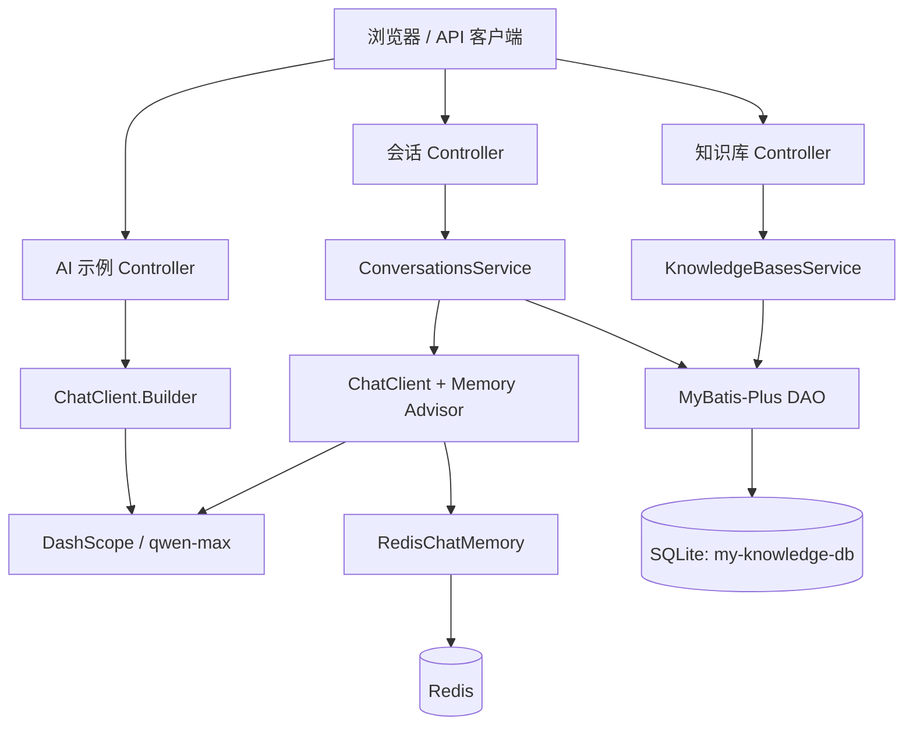
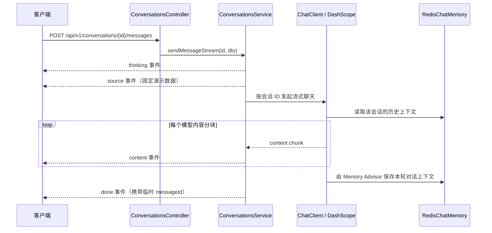

# Spring AI Demo

基于 **Spring Boot 3、Spring AI、Spring AI Alibaba 和阿里云百炼 DashScope** 的 AI 对话示例项目。项目既包含 `ChatClient` 的入门示例，也包含会话管理、Redis 对话记忆、SSE 流式输出和知识库管理等业务骨架。

默认聊天模型为 `qwen-max`，业务数据存储在 SQLite，对话上下文存储在 Redis，接口文档由 Springdoc OpenAPI 提供。

> 本文档以当前代码实现为准，会明确区分已实现能力、演示逻辑和待开发功能。当前项目尚未实现文件解析、向量化、知识检索等完整 RAG 流程。

## 目录

- [功能与实现状态](#功能与实现状态)
- [技术栈](#技术栈)
- [系统架构](#系统架构)
- [核心业务逻辑](#核心业务逻辑)
- [数据存储设计](#数据存储设计)
- [项目结构](#项目结构)
- [快速开始](#快速开始)
- [配置说明](#配置说明)
- [API 文档](#api-文档)
- [构建与测试](#构建与测试)
- [当前限制与后续规划](#当前限制与后续规划)
- [常见问题](#常见问题)

## 功能与实现状态

| 模块 | 当前能力 | 状态 |
| --- | --- | --- |
| 基础 AI 对话 | 同步文本回复、`Flux<String>` 流式回复 | 已实现 |
| 结构化输出 | 将模型结果转换为 `ActorFilms`，再以 JSON 字符串返回 | 已实现，属于固定结构示例 |
| Redis 对话记忆 | 按 `chatId` 保存和读取 user、assistant、system 消息 | 已实现 |
| 会话管理 | 创建、列表、详情、删除会话；详情从 Redis 加载消息 | 已实现 |
| 会话消息发送 | 通过 SSE 返回 thinking、source、content、done、error 事件 | 已实现，但 source 为模拟数据 |
| 会话修改 | 已声明 `PUT` 路由 | 未实现，方法体为空 |
| 知识库管理 | 创建、列表、详情、更新、删除 | 已实现 |
| 知识库统计 | 按知识库统计文件数量和 `chunkCount` 总和 | 已实现 |
| 知识文件管理 | 已定义实体、数据表、DAO 和空 Controller | 未实现上传、解析、分块和查询业务 |
| 独立消息管理 | 已定义 `messages` 表、实体、DAO 和空 Controller | 未实现；当前聊天消息实际存于 Redis |
| RAG 知识问答 | SSE 中展示知识来源事件 | 仅模拟，未接入向量库或检索流程 |

## 技术栈

| 技术 | 版本或说明 | 用途 |
| --- | --- | --- |
| Java | 17 | 开发语言与运行环境 |
| Spring Boot | 3.5.0 | Web 应用、依赖注入和自动配置 |
| Spring AI | 1.0.0-M2 | `ChatClient`、Chat Memory、流式调用等抽象 |
| Spring AI Alibaba | 1.0.0-M2.1 | DashScope 模型接入 |
| Spring AI Alibaba Redis Memory | 1.1.2.2 | Redis 记忆相关依赖 |
| MyBatis-Plus | 3.5.5 | SQLite 数据访问与通用 CRUD |
| SQLite JDBC | 3.45.1.0 | 本地关系型数据存储 |
| Jedis | 由依赖传递引入 | 自定义 `RedisChatMemory` 的 Redis 客户端 |
| Reactor | 由 Spring AI/Web 依赖引入 | `Flux<String>` 响应式流 |
| Springdoc OpenAPI | 2.7.0 | Swagger UI 与 OpenAPI 文档 |
| Hutool | 5.8.25 | Bean 转换、JSON 等工具能力 |
| Lombok | 编译期依赖 | 简化实体和 DTO 代码 |
| Maven Wrapper | Maven 3.9.6 | 项目构建与依赖管理 |

当前依赖包含里程碑版本，适合学习和原型验证；用于生产环境前，应评估版本稳定性并统一依赖版本。

## 系统架构



### 分层职责

- `controller`：接收 HTTP 请求，包含基础 AI 示例和 `/api/v1` 业务接口。
- `service`：实现会话、SSE 消息发送、知识库统计与级联删除等业务逻辑。
- `dao`：基于 MyBatis-Plus `BaseMapper` 访问 SQLite。
- `entity`：数据库实体、请求 DTO、响应 VO 和统一响应体 `MyResult`。
- `config`：配置 `ChatClient`、Redis 记忆、MyBatis 和 OpenAPI。

## 核心业务逻辑

### 1. 基础 AI 调用

基础示例接口通过注入的 `ChatClient.Builder` 创建客户端，并注册 `SimpleLoggerAdvisor`：

1. 接收 `input` 或 `prompt` 请求参数。
2. 将内容作为用户消息交给 DashScope 聊天模型。
3. 根据接口选择 `.call()` 同步返回，或 `.stream()` 以 `Flux<String>` 分块返回。
4. `/entity/chat` 额外使用 `.entity(ActorFilms.class)` 做结构化转换。

这些示例接口与 `/api/v1/conversations` 的业务会话是两套入口；基础接口不会创建 SQLite 会话记录。

### 2. 会话创建与历史查询

1. 创建会话时，将标题和 `knowledgeBaseIds` 保存到 SQLite 的 `conversations` 表。
2. 会话 ID 由 MyBatis-Plus 的 `IdType.ASSIGN_UUID` 生成。
3. 查询会话详情时，先读取 SQLite 中的会话元数据，再根据会话 ID 从 Redis 读取聊天消息。
4. Redis 中的消息被转换为 `MessageVO`，当前只填充 `role` 和 `content`。
5. 删除会话时，先删除 Redis 中对应的 `chat:{conversationId}`，再删除 SQLite 中的会话记录。

`knowledgeBaseIds` 当前只是会话上的关联字段，尚未用于检索或模型提示词增强。

### 3. SSE 流式发送消息

`POST /api/v1/conversations/{id}/messages` 的处理时序如下：



需要注意：

- 请求 DTO 中虽然有 `isStream` 字段，但当前接口始终使用 SSE，不根据该字段切换同步响应。
- `thinking` 中的“正在检索相关知识”和 `source` 中的文件、分数是演示逻辑，并不代表执行了真实检索。
- 每次回复的 `messageId` 是临时生成的 UUID，目前没有落库。
- SSE 的事件类型放在 JSON 的 `type` 字段中，而不是 SSE 协议的 `event:` 行中。

### 4. Redis 对话记忆

自定义 `RedisChatMemory` 使用 Redis Hash 保存消息：

```text
Key:    chat:{conversationId}
Field:  毫秒时间戳（同一批消息依次递增）
Value:  type|content
```

支持的消息类型：

- `user|用户消息`
- `assistant|AI 回复`
- `system|系统消息`

读取时按时间戳排序，并根据 `type|` 前缀恢复为对应 Spring AI Message。没有类型前缀的旧数据会按用户消息兼容处理。

业务会话使用 `ClientConfig` 中配置了 `MessageChatMemoryAdvisor` 的 `ChatClient`，因此模型调用可以携带同一 conversation ID 的历史上下文。`/memory/redis/stream` 是独立验证该能力的示例接口。

### 5. 知识库管理

- **创建**：生成 `kb_` 前缀加 10 位字符的 ID，并写入创建、更新时间。
- **列表**：查询所有知识库，再逐个统计关联文件数和分块总数，结果位于 `data.list`。
- **详情**：返回知识库基础信息以及 `fileCount`、`totalChunks`。
- **更新**：仅更新请求中非 `null` 的 `name`、`description`，同时刷新 `updatedAt`。
- **删除**：先删除 `knowledge_files` 中该知识库的文件记录，再删除知识库本身。

这里的“文件统计”只基于数据库记录。当前没有真实文件上传和索引任务，也不会在删除知识库时删除磁盘文件或向量数据。

## 数据存储设计

### SQLite

默认数据库文件为项目根目录下的 `my-knowledge-db`，JDBC URL 为 `jdbc:sqlite:my-knowledge-db`。

| 表 | 主要字段 | 当前用途 |
| --- | --- | --- |
| `conversations` | `id`、`title`、`knowledge_base_ids`、`created_at`、`updated_at` | 保存会话元数据 |
| `knowledge_bases` | `id`、`name`、`description`、`created_at`、`updated_at` | 保存知识库基础信息 |
| `knowledge_files` | `id`、`name`、`type`、`size`、`knowledge_base_id`、`status`、`chunk_count`、`storage_path`、时间字段 | 保存文件元数据；当前用于统计和级联删除 |
| `messages` | `id`、`conversation_id`、`role`、`content`、`sources`、`created_at` | 预留的消息表，当前对话链路未使用 |

逻辑关系：

```text
knowledge_bases 1 ── N knowledge_files
conversations   1 ── N Redis 中的聊天消息（通过 chat:{conversationId} 关联）
messages        预留表，尚未接入当前业务
```

项目没有使用 Flyway 或 Liquibase，也没有自动建表脚本。运行时应保留现有 SQLite 文件，并确保从项目根目录启动；使用其他工作目录或修改 JDBC URL 时，需要自行准备相同表结构。

### SQLite 与 Redis 的边界

- SQLite 回答“有哪些会话、知识库和文件记录”。
- Redis 回答“某个会话聊过什么”。
- 当前不会把 Redis 中的聊天消息同步写入 `messages` 表。
- Redis 消息未设置 TTL；清理依赖删除会话或显式调用 `clear`。

## 项目结构

```text
spring-ai-demo/
├── src/main/java/com/example/demo/
│   ├── config/
│   │   ├── ClientConfig.java              # 带记忆 Advisor 的业务 ChatClient
│   │   ├── RedisChatMemory.java           # Redis Hash 对话记忆实现
│   │   ├── MybatisConfig.java             # MyBatis 配置
│   │   └── OpenApiConfig.java             # Swagger/OpenAPI 配置
│   ├── controller/
│   │   ├── AiChatController.java          # 基础同步/流式对话
│   │   ├── AiChatMemoryController.java    # 记忆参数示例
│   │   ├── AiChatMemoryRedisController.java # Redis 记忆对话示例
│   │   ├── AiChatReturnEntityController.java # 结构化输出示例
│   │   └── api/
│   │       ├── ConversationsController.java
│   │       ├── KnowledgeBasesController.java
│   │       ├── KnowledgeFilesController.java # 空实现骨架
│   │       └── MessagesController.java       # 空实现骨架
│   ├── service/                           # 业务接口
│   ├── service/impl/                      # 会话与知识库业务实现
│   ├── dao/                               # MyBatis-Plus Mapper
│   ├── entity/                            # 数据库实体与统一响应体
│   │   ├── dto/                           # 请求对象
│   │   └── vo/                            # 响应视图对象
│   └── SpringAiDemoApplication.java
├── src/main/resources/application.yml     # AI、Redis、SQLite、日志和 Swagger 配置
├── src/test/java/                         # Spring 上下文测试
├── examples/usage-example.ts              # 前端消费流的参考片段，不是独立可运行客户端
├── my-knowledge-db                        # 默认 SQLite 数据库
├── pom.xml
└── mvnw / mvnw.cmd                        # Maven Wrapper
```

## 快速开始

### 1. 环境要求

- JDK 17。
- 可访问的 Redis，默认 `127.0.0.1:6379`。
- 有效的阿里云百炼 DashScope API Key。
- 首次构建时可访问 Maven Central、Spring Milestones 和阿里云 Maven 仓库。

无需单独安装 Maven，可直接使用项目中的 Maven Wrapper。

### 2. 准备配置

不要提交真实 API Key。推荐使用环境变量覆盖 `application.yml`：

```bash
export SPRING_AI_DASHSCOPE_API_KEY="你的 DashScope API Key"
export SPRING_DATA_REDIS_HOST="127.0.0.1"
export SPRING_DATA_REDIS_PORT="6379"
```

如 Redis 设置了密码：

```bash
export SPRING_DATA_REDIS_PASSWORD="你的 Redis 密码"
```

确认 Redis 可用：

```bash
redis-cli ping
# 预期输出：PONG
```

### 3. 启动项目

在项目根目录执行：

```bash
bash mvnw spring-boot:run
```

如果 `mvnw` 已有可执行权限，也可以使用：

```bash
./mvnw spring-boot:run
```

默认服务地址为 `http://localhost:8080`。

### 4. 验证

- Swagger UI：<http://localhost:8080/swagger-ui.html>
- OpenAPI JSON：<http://localhost:8080/v3/api-docs>
- 基础对话：`GET http://localhost:8080/chat?input=你好`

## 配置说明

| 配置项 | 对应环境变量 | 当前默认值 | 说明 |
| --- | --- | --- | --- |
| `spring.ai.dashscope.api-key` | `SPRING_AI_DASHSCOPE_API_KEY` | 配置文件提供 | DashScope 密钥，必须改为安全注入 |
| `spring.ai.dashscope.chat.options.model` | `SPRING_AI_DASHSCOPE_CHAT_OPTIONS_MODEL` | `qwen-max` | 默认聊天模型 |
| `spring.data.redis.host` | `SPRING_DATA_REDIS_HOST` | `127.0.0.1` | Redis 主机 |
| `spring.data.redis.port` | `SPRING_DATA_REDIS_PORT` | `6379` | Redis 端口 |
| `spring.data.redis.password` | `SPRING_DATA_REDIS_PASSWORD` | 空 | Redis 密码，可为空 |
| `spring.datasource.url` | `SPRING_DATASOURCE_URL` | `jdbc:sqlite:my-knowledge-db` | SQLite 文件路径 |
| `openapi.service.url` | `OPENAPI_SERVICE_URL` | `http://localhost:8080` | Swagger 中展示的服务地址 |

其他当前配置：

- MyBatis-Plus 开启下划线转驼峰，并向标准输出打印 SQL。
- Spring AI Advisor 日志级别为 `debug`。
- 未显式配置 `server.port`，因此使用 Spring Boot 默认端口 `8080`。

生产环境不要沿用 SQL 全量输出、AI 调试日志和开放跨域配置。

## API 文档

### 通用约定

业务接口基础地址：

```text
http://localhost:8080
```

会话和知识库接口使用统一响应体：

```json
{
  "code": 200,
  "message": "success",
  "data": {}
}
```

无数据的成功操作返回 `"data": null`。这里的 `code` 是应用层字段，当前异常并没有统一转换为该结构；参数校验和异常响应仍需完善。

### 基础 AI 示例接口

| 方法 | 路径 | 参数 | 返回与说明 |
| --- | --- | --- | --- |
| GET | `/chat` | `input` | 同步返回模型文本 |
| GET | `/stream` | `input` | 返回 `Flux<String>` 内容分块；不是业务 SSE 事件流 |
| GET | `/memory/stream` | `prompt`、`chatId` | 流式记忆参数示例；当前未启用 Memory Advisor，不保证具有记忆能力 |
| GET | `/memory/redis/stream` | `prompt`、`chatId` | 使用 Redis 记忆的流式对话 |
| GET | `/entity/chat` | `input` | 按 `ActorFilms(actor, movies)` 转换并返回 JSON 字符串 |

示例：

```bash
curl --get 'http://localhost:8080/chat' \
  --data-urlencode 'input=用一句话介绍 Spring AI'

curl --get 'http://localhost:8080/memory/redis/stream' \
  --data-urlencode 'prompt=我叫小明，请记住我的名字' \
  --data-urlencode 'chatId=demo-chat-001'

curl --get 'http://localhost:8080/entity/chat' \
  --data-urlencode 'input=请列出演员 Tom Hanks 的三部代表作'
```

### 会话接口

| 方法 | 路径 | 状态 | 说明 |
| --- | --- | --- | --- |
| GET | `/api/v1/conversations` | 已实现 | 查询全部会话，不附带消息列表 |
| GET | `/api/v1/conversations/getByConversationId/{id}` | 已实现 | 查询会话详情，并从 Redis 加载消息 |
| POST | `/api/v1/conversations/create` | 已实现 | 创建会话 |
| POST | `/api/v1/conversations/{id}/messages` | 已实现 | 发送消息并返回 SSE |
| DELETE | `/api/v1/conversations/{id}` | 已实现 | 删除会话及其 Redis 消息 |
| PUT | `/api/v1/conversations` | 未实现 | 路由存在，但方法体为空 |

#### 创建会话

```bash
curl -X POST 'http://localhost:8080/api/v1/conversations/create' \
  -H 'Content-Type: application/json' \
  -d '{
    "title": "Spring AI 学习",
    "knowledgeBaseIds": "kb_示例ID"
  }
```

响应中的 `data.id` 是后续查询、发送消息和删除会话所需的会话 ID。

#### 查询会话详情

```bash
curl 'http://localhost:8080/api/v1/conversations/getByConversationId/会话ID'
```

详情中的消息结构为：

```json
{
  "id": null,
  "role": "assistant",
  "content": "模型回复内容",
  "timestamp": null,
  "sources": null
}
```

当前只有 `role` 和 `content` 会从 Redis 消息中填充，其余字段为预留字段。

#### SSE 发送消息

```bash
curl -N -X POST 'http://localhost:8080/api/v1/conversations/会话ID/messages' \
  -H 'Content-Type: application/json' \
  -H 'Accept: text/event-stream' \
  -d '{"content":"请介绍 Spring AI 的 ChatClient"}'
```

`isStream` 可以省略，因为当前端点固定返回 SSE。

事件类型：

| `type` | 数据字段 | 含义 |
| --- | --- | --- |
| `thinking` | `content` | 处理状态提示 |
| `source` | `data` | 引用来源；当前为固定模拟数据 |
| `content` | `content` | 一个模型输出分块，客户端应顺序拼接 |
| `done` | `messageId` | 本轮输出完成 |
| `error` | `message` | 处理失败信息 |

典型数据帧：

```text
data: {"type":"thinking","content":"正在检索相关知识..."}

data: {"type":"source","data":{"fileId":"file_001","fileName":"SpringBoot自动配置详解.pdf","score":0.92}}

data: {"type":"content","content":"Spring"}

data: {"type":"content","content":" AI"}

data: {"type":"done","messageId":"随机 UUID"}
```

由于原生 `EventSource` 主要面向 GET，可使用 `fetch + ReadableStream` 或支持 POST 的 SSE 客户端消费该接口。

### 知识库接口

| 方法 | 路径 | 请求体 | 说明 |
| --- | --- | --- | --- |
| GET | `/api/v1/knowledge-bases` | 无 | 列表，数据位于 `data.list` |
| POST | `/api/v1/knowledge-bases` | `name`、`description` | 创建知识库 |
| GET | `/api/v1/knowledge-bases/{id}` | 无 | 查询详情及统计信息 |
| PUT | `/api/v1/knowledge-bases/{id}` | 可选 `name`、`description` | 非空字段更新 |
| DELETE | `/api/v1/knowledge-bases/{id}` | 无 | 删除知识库及其文件记录 |

创建示例：

```bash
curl -X POST 'http://localhost:8080/api/v1/knowledge-bases' \
  -H 'Content-Type: application/json' \
  -d '{
    "name": "Spring 技术资料",
    "description": "Spring Boot 与 Spring AI 学习资料"
  }'
```

创建成功示例：

```json
{
  "code": 200,
  "message": "success",
  "data": {
    "id": "kb_1a2b3c4d5e",
    "name": "Spring 技术资料",
    "description": "Spring Boot 与 Spring AI 学习资料",
    "createdAt": "创建时间",
    "updatedAt": "创建时间"
  }
}
```

列表和详情中的只读统计字段：

- `fileCount`：该知识库在 `knowledge_files` 中的记录数。
- `totalChunks`：这些记录的 `chunkCount` 之和，`null` 按 0 处理。

### 空实现接口

以下路由已经生成 Controller 骨架，但方法体为空，不应当作可用业务接口：

- `/knowledgeFiles` 下的列表、详情、新增、修改和批量删除。
- `/messages` 下的列表、详情、新增、修改和批量删除。
- `PUT /api/v1/conversations`。

调用这些接口不会完成对应的数据变更或查询。

## 构建与测试

### 运行测试

```bash
bash mvnw test
```

当前只有 `SpringAiDemoApplicationTests.contextLoads()`，用于验证 Spring 容器能够启动，不包含 Controller、Service、Redis 或 DashScope 的业务断言。该测试不会主动发送一次聊天请求，但启动上下文仍依赖现有配置能够正常加载。

### 构建可执行 JAR

```bash
bash mvnw clean package
java -jar target/spring-ai-demo-0.0.1-SNAPSHOT.jar
```

启动 JAR 前仍需准备 DashScope Key、Redis 和正确的 SQLite 工作目录。

## 当前限制与后续规划

### 使用当前版本时必须了解

1. **不是完整 RAG**：没有文档上传、文本切分、Embedding、向量存储、召回和提示词注入；SSE 的来源事件是硬编码示例。
2. **消息存在两套模型**：实际聊天历史在 Redis，`messages` 表及其 Controller 尚未接入，不能直接从该表查询当前会话历史。
3. **会话校验不足**：发送消息前未显式检查会话是否存在，请求字段也缺少 Bean Validation。
4. **异常格式不统一**：例如知识库不存在时抛出 `RuntimeException`，不会自动转换为 `MyResult.error(...)`。
5. **SSE 实现较简化**：使用手动创建线程，缺少统一异步线程池、客户端断连处理、超时策略和持久化完成确认。
6. **统计查询存在 N+1**：知识库列表会针对每个知识库单独查询文件，数据量大时需要聚合 SQL。
7. **级联删除无事务声明**：知识库文件记录与主记录的删除尚未通过 `@Transactional` 保证原子性。
8. **历史读取细节**：Redis 当前按时间升序后执行 `limit(lastN)`，严格意义上不是“最近 N 条”语义，且未设置过期时间。
9. **测试覆盖有限**：只有上下文加载测试，尚无接口和核心业务自动化测试。
10. **安全配置待加强**：部分接口允许任意跨域，缺少认证授权，调试日志较多。

### 推荐迭代顺序

1. 统一配置外置、参数校验、异常响应和认证授权。
2. 明确消息唯一存储方案，补齐消息 ID、时间、来源及持久化。
3. 实现知识文件上传、状态流转和文件管理接口。
4. 接入文档解析、分块、Embedding、向量库和检索 Advisor，替换模拟 source。
5. 将 `knowledgeBaseIds` 真正用于会话级知识检索和权限隔离。
6. 完善事务、聚合统计、SSE 异步生命周期和自动化测试。

## 常见问题

### `mvnw: permission denied`

当前环境可直接使用 `bash mvnw ...`，无需修改文件权限；Windows 使用 `mvnw.cmd`。

### 调用模型返回 401、403 或鉴权错误

检查 `SPRING_AI_DASHSCOPE_API_KEY` 是否有效、账户是否开通对应模型，以及环境变量是否注入到了实际启动进程。

### 报 Redis 连接失败

确认 Redis 地址、端口和密码正确，并执行 `redis-cli ping`。默认连接 `127.0.0.1:6379`，会话详情、Redis 记忆对话和删除会话都依赖 Redis。

### 启动后提示找不到数据表

确认从项目根目录启动，并且 `spring.datasource.url` 指向项目自带的 `my-knowledge-db`。相对 SQLite 路径会随工作目录变化，项目不会自动建表。

### 为什么 `source` 总是同一个 PDF

这是 `ConversationsServiceImpl` 中用于演示 SSE 协议的固定数据，并非从知识库检索得到。接入真实 RAG 前，不应将其作为回答可信度依据。

### 为什么 `messages` 表没有当前聊天内容

当前会话消息由 `RedisChatMemory` 保存到 Redis Hash，`MessagesController` 和对应 Service 只是空骨架，尚未承担聊天持久化。

### 如何查看和清理某个会话的 Redis 数据

```bash
redis-cli HGETALL 'chat:会话ID'
redis-cli DEL 'chat:会话ID'
```

优先使用删除会话接口，以同时清理 SQLite 会话记录和 Redis 消息，避免只清理一侧造成数据不一致。
